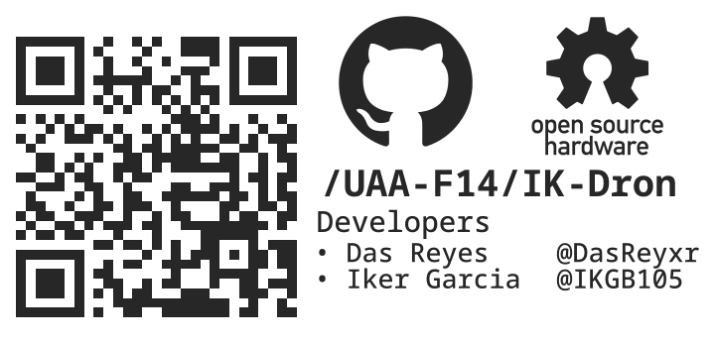

# IK-Dron

A 5" FPV racing drone (LS210 carbon-fiber frame) built, diagnosed and flown as a university electronics project. The drone originally shipped with a CC3D flight controller on LibrePilot, which suffered an unrecoverable microcontroller failure during testing — documented here is the migration to a modern SpeedyBee F405 V4 stack on BetaFlight, the full diagnostic process from BetaFlight's CLI, and the configuration that got it to a stable, controlled flight on October 13, 2026. On October 23 it was updated to BetaFlight 2026.6.2 to add altitude hold using the flight controller's onboard barometer.

| Component | Spec |
|---|---|
| Frame | LS-210, 3K carbon fiber, 210 mm motor-to-motor |
| Flight controller | SpeedyBee F405 V4 (STM32F405, ICM42688P gyro, DPS310 baro) |
| ESC | SpeedyBee BLS 60A 4-in-1, DSHOT300 |
| Motors | FlashHobby BE1806, 2300 KV |
| Receiver | FlySky FS-iA6B, IBUS |
| Firmware | BetaFlight 2026.6.2, target `SPEEDYBEEF405V4` |
| Total weight | 497 g |
| Flight modes | ANGLE (always on), ALTHOLD on AUX2 |

## Directory structure
```
├── docs
│   ├── LogFile.pdf
│   ├── REPORTE_Drone_2021_OK.pdf
│   ├── REPORTE_Drone_2021_TEX.pdf
│   ├── REPORTE_Drone_2026.pdf
│   ├── generalconfig.tex
│   ├── LogFile.tex
│   ├── REPORTE_Drone_2021_TEX.tex
│   ├── REPORTE_Drone_2026.tex
│   ├── sn-jnl.cls
│   └── src
├── images
│   ├── dron.png
│   ├── QR.png
│   └── schematic.png
├── README.md
└── scripts
    ├── baud_rate_scanner.py
    ├── bfcli.py
    ├── msp_acc_calib.py
    └── Serialdetector.py


```


- [`docs/REPORTE_Drone_2026.pdf.pdf`](docs/REPORTE_Drone_2026.pdf.pdf) — technical report: system architecture, specs, firmware configuration, operation manual (controls, battery, arming, altitude hold, emergencies), troubleshooting guide, safety procedures, and how to flash the firmware from the terminal.

- [`docs/LogFile.pdf`](docs/LogFile.pdf) — full day-by-day build log (March–October 2026) with photos, incidents, and the reasoning behind each configuration change. Referenced throughout the technical report.

- [`docs/REPORTE_Drone_2021_OK.pdf`](docs/REPORTE_Drone_2021_OK.pdf) — the first-generation (2021) project report this one continues from, which selected the frame/motor/battery still in use and designed a custom STM32F446RE flight controller (later dropped in favor of commercial ones for cost reasons).

LaTeX sources for the first two are also included (`docs/*.tex`, `docs/sn-jnl.cls`, `docs/generalconfig.tex`, images under `docs/src/`) if you want to rebuild them.

## Scripts

- [`scripts/baud_rate_scanner.py`](scripts/baud_rate_scanner.py) — probes a serial port across common baud rates to find which one a connected flight controller responds on.

- [`scripts/bfcli.py`](scripts/bfcli.py) — sends commands to the BetaFlight CLI over USB and prints the replies (e.g. `python3 bfcli.py version status "diff all"`). Exits without saving unless the last command is `save`.

- [`scripts/msp_acc_calib.py`](scripts/msp_acc_calib.py) — triggers accelerometer calibration over MSP, same as the Configurator button. The drone must be flat and still.

- [`scripts/Serialdetector.py`](scripts/Serialdetector.py) — lists all serial ports and their descriptions, then waits for a new one to appear (e.g. when the flight controller is plugged in). Useful for identifying which port to use with the other scripts.

Both use `/dev/ttyACM0` by default; set `BF_PORT=COM5` (or similar) on Windows. Close BetaFlight Configurator first, since only one program can hold the port.


## Credit

Built with [Orlando Contreras (DasReyxr)](https://github.com/DasReyxr) as a two-person team project, advised by Dr. Luis Antonio Raygoza Pérez — Department of Electronic Systems, Universidad Autónoma de Aguascalientes.


## Template
```
mkdir code design doc scripts sim src
```

```
tree >> README.md
```


